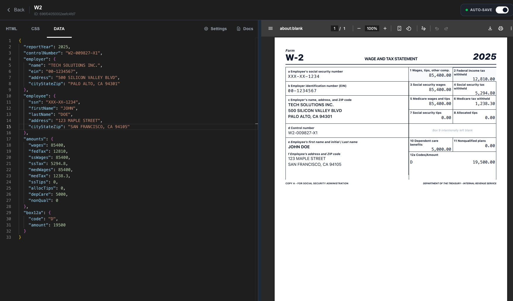

# PDFGenAI

AI-powered PDF generation platform with template management, OAuth 2.0 authentication, and Model Context Protocol (MCP) integration for AI assistants.
 


## Features

### Core Functionality
- **Template-Based PDF Generation**: Create PDFs using Handlebars templates with dynamic data
- **Template Management**: Full CRUD operations for PDF templates with HTML/CSS support
- **Document Storage**: Secure document storage and retrieval via Appwrite
- **Real-time Preview**: Live preview of templates before generation

### Authentication & Security
- **OAuth 2.0 Flow**: Complete OAuth implementation with authorization code grant
- **API Key Management**: Generate and manage API keys for programmatic access
- **Hybrid Authentication**: Support for both API keys and OAuth tokens
- **MCP Integration**: Model Context Protocol support for AI assistants (Claude Code, ChatGPT)

### AI Integration
- **MCP Server**: Expose PDF generation capabilities to AI assistants
- **OAuth Consent Flow**: User-friendly authorization for AI platforms
- **Tool Definitions**: `generate_pdf` and `list_templates` tools for AI agents

## Tech Stack

- **Framework**: Next.js 16 (App Router, Turbopack)
- **Language**: TypeScript
- **Backend**: Appwrite (Database, Storage, Authentication)
- **PDF Engine**: Puppeteer
- **Template Engine**: Handlebars
- **Styling**: Tailwind CSS 4
- **Authentication**: OAuth 2.0, JWT

## Prerequisites

- Node.js 22.12+ (required by Puppeteer 25)
- npm or pnpm
- Appwrite instance (cloud or self-hosted)

## Installation

```bash
# Clone the repository
git clone <repository-url>
cd pdf-gen-ai

# Install dependencies
npm install

# Configure environment variables
cp .env.example .env
```

## Environment Variables

Create a `.env` file with the following variables:

```bash
# Appwrite Configuration
NEXT_PUBLIC_APPWRITE_ENDPOINT=https://cloud.appwrite.io/v1
NEXT_PUBLIC_APPWRITE_PROJECT_ID=your_project_id
NEXT_PUBLIC_APPWRITE_DATABASE_ID=your_database_id
APPWRITE_API_KEY=your_api_key

# Collections
NEXT_PUBLIC_TEMPLATES_COLLECTION_ID=templates
NEXT_PUBLIC_DOCUMENTS_COLLECTION_ID=documents
NEXT_PUBLIC_API_KEYS_COLLECTION_ID=api_keys
OAUTH_CODES_COLLECTION_ID=oauth_codes
OAUTH_TOKENS_COLLECTION_ID=oauth_tokens

# generation mode
PDF_GENERATION_MODE=sync #sync or queue (queue use appwrite functions)
PDF_GENERATION_TIMEOUT=30

# Storage
NEXT_PUBLIC_DOCUMENTS_BUCKET_ID=documents

# Application
NEXT_PUBLIC_DOMAIN=https://your-domain.com
NEXT_PUBLIC_APP_URL=https://your-domain.com
JWT_SECRET=your_jwt_secret
MCP_API_KEY=your_mcp_api_key
```

## Development

```bash
# Start development server
npm run dev

# Build for production
npm run build

# Start production server
npm start

# Run linter
npm run lint
```

## Deployment

### Production Build
```bash
npm run build
```

### Production Runtime (Appwrite / Linux)
Puppeteer 25 manages its compatible Chrome for Testing revision (`157.0.8103.78`) at install time. `.puppeteerrc.cjs` keeps that browser in the project's `.cache/puppeteer` directory so Docker includes it in the image.

1. Use Node.js 22.12 or newer.
2. Run `npm ci` (Docker already does this) and allow Puppeteer's install script to download the managed browser.
3. Set `PUPPETEER_EXECUTABLE_PATH` only when supplying a separately verified compatible Chrome executable. Do not set a skip-download variable without that override.
4. The application retains its sandbox-safe launch flags and blocks private browser requests.

The development server runs on `http://localhost:3030`

## API Documentation

### Authentication

All API endpoints require authentication via:
- **Bearer Token**: `Authorization: Bearer <token>`
- **API Key**: `Authorization: Bearer <api_key>`

### Endpoints

#### Templates

```http
GET    /api/v1/templates           # List all templates
POST   /api/v1/templates           # Create template
GET    /api/v1/templates/:id       # Get template
PUT    /api/v1/templates/:id       # Update template
DELETE /api/v1/templates/:id       # Delete template
GET    /api/v1/templates/:id/html  # Get template HTML
```

#### Documents

```http
GET    /api/v1/documents           # List documents
POST   /api/v1/generate            # Generate PDF
GET    /api/v1/documents/:id       # Get document
DELETE /api/v1/documents/:id       # Delete document
GET    /api/v1/documents/:id/download  # Download PDF
```

#### Authentication

```http
POST   /api/v1/auth/register       # Register user
POST   /api/v1/auth/login          # Login
POST   /api/v1/auth/logout         # Logout
GET    /api/v1/auth/me             # Get current user
POST   /api/v1/auth/api-key        # Generate API key
```

### MCP Integration

#### OAuth Endpoints

```http
GET    /api/llm/mcp/.well-known/oauth-authorization-server  # OAuth metadata
GET    /api/llm/mcp/auth          # Authorization endpoint
POST   /api/llm/mcp/token         # Token exchange
```

#### MCP Tools

```http
GET    /api/llm/mcp               # SSE handshake
POST   /api/llm/mcp               # MCP message processing
```

**Available Tools**:
- `generate_pdf`: Generate PDF from template
- `list_templates`: List available templates

## MCP Setup

### Claude Code

```bash
claude mcp add pdfgenai https://your-domain.com/api/llm/mcp \
  --env "AUTHORIZATION=Bearer ${MCP_API_KEY}"
```

### ChatGPT

1. Go to Custom GPT settings
2. Add MCP integration:
   - **URL**: `https://your-domain.com/api/llm/mcp`
   - **OAuth Client ID**: Your User ID
   - **OAuth Secret**: Your API Key

## Database Schema

### Collections

#### `templates`
- `name` (string): Template name
- `description` (string): Template description
- `html_content` (string): Handlebars HTML template
- `sample_data` (object): Sample JSON data
- `user_id` (string): Owner user ID

#### `documents`
- `template_id` (string): Reference to template
- `file_id` (string): Appwrite storage file ID
- `file_name` (string): PDF filename
- `data` (object): Generation data
- `user_id` (string): Owner user ID

#### `api_keys`
- `user_id` (string): Owner user ID
- `key` (string): JWT token
- `name` (string): Key name
- `created_at` (datetime): Creation timestamp

#### `oauth_codes`
- `code` (string): Authorization code
- `client_id` (string): OAuth client ID
- `user_id` (string): User ID
- `redirect_uri` (string): Redirect URI
- `scopes` (array): Requested scopes
- `code_challenge` (string): PKCE challenge
- `expires_at` (datetime): Expiration time

#### `oauth_tokens`
- `client_id` (string): OAuth client ID
- `user_id` (string): User ID
- `access_token` (string): Access token
- `refresh_token` (string): Refresh token
- `scopes` (array): Granted scopes
- `expires_at` (datetime): Expiration time

## Project Structure

```
pdf-gen-ai/
├── src/
│   ├── app/
│   │   ├── (dashboard)/        # Dashboard pages
│   │   ├── api/                # API routes
│   │   │   ├── llm/mcp/       # MCP endpoints
│   │   │   └── v1/            # V1 API
│   │   └── oauth/             # OAuth pages
│   ├── components/            # React components
│   ├── lib/                   # Utilities
│   │   ├── appwrite.ts       # Appwrite config
│   │   ├── auth.ts           # Authentication
│   │   ├── oauth-service.ts  # OAuth services
│   │   └── pdf-generator.ts  # PDF generation
│   └── types/                # TypeScript types
├── public/                   # Static assets
└── scripts/                  # Utility scripts
```

## Security

- All endpoints require authentication
- API keys are stored as JWTs
- OAuth tokens use PKCE for public clients
- Passwords are hashed via Appwrite
- CORS configured for production domain

## License

MIT License - see LICENSE file for details

## Contributing

Contributions are welcome! Please open an issue or submit a pull request.

## Support

For issues and questions, please open a GitHub issue.
